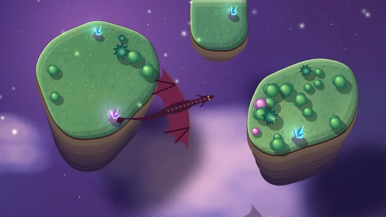
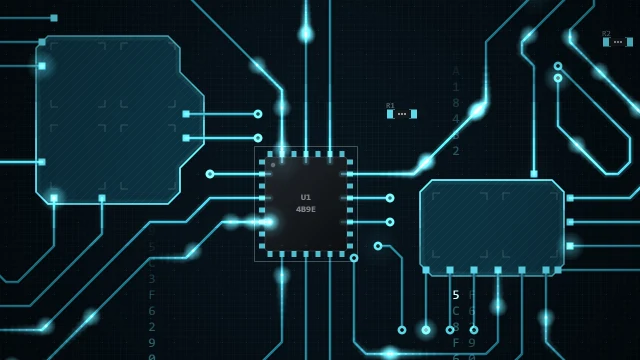
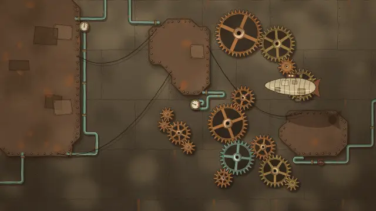
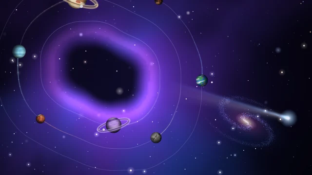

# IconScape

**Adaptive Windows wallpaper that makes your desktop icons part of the scenery.**

> **IconScape is a modified version of [Deskland Preview](https://github.com/BLEZZ0102/Deskland)**, released under the same GPL-3.0 license. It is not an official Deskland release and is not endorsed by the Deskland authors. As they ask of modified distributions, it uses its own name and icon ([TRADEMARKS.md](TRADEMARKS.md)). Version 0.1.4, based on Deskland Preview 0.1.3; see [Changes from Deskland Preview](#changes-from-deskland-preview).

IconScape turns the space around your icons into a living landscape. Move, add or remove an icon and the beach, meadow, islands, clouds and shadows quietly reshape around it — in real time, without AI, an account or an API key.

**English** · [Italiano](#italiano) · [简体中文](#中文说明) · [Features](#features) · [Build from source](#build-from-source)


## Themes

From Deskland Preview:

| Beach | Meadow |
| --- | --- |
|  |  |
| Turquoise waves, kayaks, seabirds and coconut palms. | Drifting clouds and shadows, a boy flying a kite and a little black cat. |

Added in IconScape:

| Floating Isles | Circuit |
| --- | --- |
|  |  |
| Grassy islands above a sea of clouds at dusk, dawn, day or night; glowing crystals, magic motes and a passing dragon. | A dark circuit board with copper pours under the icons, 45° traces, data pulses, LEDs and falling hex digits. |

| Steampunk | Cosmos |
| --- | --- |
|  |  |
| Riveted metal plates, meshing gears, copper pipes with pressure gauges and steam, and a passing airship. | Every group of icons is a star system: orbits follow its shape, planets travel along them, with nebulae, a spiral galaxy, shooting stars and comets. |

The theme list contains only these six themes. The locked preview cards of Deskland's paid Wallpaper edition, which Deskland Preview shows, are not part of IconScape.

## Features

- **Adaptive scenery:** uses the real positions of desktop icons and transitions smoothly when they move.
- **Six complete themes:** every setting for Beach, Meadow, Floating Isles, Circuit, Steampunk and Cosmos is included and saved between sessions.
- **Every monitor, one landscape:** the scene is computed over the whole desktop as your monitors are arranged, and each monitor shows its part: islands, coasts, clouds, boards and orbits continue from one monitor to the next, and a dragon, an airship or a comet crosses from one to the other. Monitors can be added, removed or rearranged while IconScape runs.
- **Made for the desktop:** tray controls, startup on sign-in and automatic pause of each monitor that a maximized or full-screen window covers, even when that window is not in the foreground.
- **Private sharing:** image and animation exports use sample icons and color blocks, never a screenshot of your desktop or real file names.
- **Independent installation:** IconScape uses its own install directory, settings, startup entry and instance identity, so it can coexist with Deskland.
- **English, Italian and Simplified Chinese:** no sign-in, purchase restoration, update service or store API is included.

## Requirements

- Windows 10 or Windows 11, 64-bit.
- Microsoft Edge WebView2 Runtime.
- PowerShell and the .NET Framework C# compiler included with Windows; no .NET SDK installation is required.
- An internet connection for the first build, which downloads the WebView2 development library.
- Node.js is optional: the browser preview can also be served with the included PowerShell script.

IconScape renders on **every connected monitor** and targets 30 fps on integrated graphics.

## Build from source

Open PowerShell in the repository root:

```powershell
powershell -ExecutionPolicy Bypass -File host\build.ps1
host\bin\IconScape.exe
```

Keep `host/` and `prototype/` together. Build output is written to `host/bin/`.

Run the program again or double-click its tray icon to open Settings. To exit and restore the original Windows wallpaper, use the tray menu or run:

```powershell
host\bin\IconScape.exe --exit
```

Settings and logs are stored in `%LOCALAPPDATA%\IconScape`; shared images and clips in `Pictures\IconScape`. On the first start IconScape copies your settings from `%LOCALAPPDATA%\DesklandPreview` if that folder exists; an installed Deskland Preview keeps its own data.

## Browser preview

```powershell
node prototype\serve.mjs
```

Without Node.js, serve the same folder on the same port with:

```powershell
powershell -ExecutionPolicy Bypass -File tools\serve.ps1
```

Open **http://localhost:5178/settings.html**. The browser uses sample icons; adaptation to real desktop icons requires the Windows host.

## Windows installer

Build the NSIS installer without installing global development tools:

```powershell
powershell -ExecutionPolicy Bypass -File tools\build-installer.ps1
```

The first build downloads portable NSIS and Microsoft's WebView2 bootstrapper. Artifacts are written to `dist/` with SHA256 checksums and a matching source ZIP.

The installer targets the current user's `Programs\IconScape` directory and does not require administrator rights. If WebView2 is missing, its bootstrapper requires an internet connection. Uninstalling preserves user settings. No IconScape installer has been published: build it from source.

## Project layout

| Path | Contents |
| --- | --- |
| `host/` | Windows host, build scripts, application manifest and icon (`IconScape.ico`) |
| `prototype/flat.html` | Beach theme (from Deskland Preview) |
| `prototype/meadow.html` | Meadow theme (from Deskland Preview) |
| `prototype/isles.html` | Floating Isles theme |
| `prototype/circuit.html` | Circuit theme |
| `prototype/steam.html` | Steampunk theme |
| `prototype/cosmos.html` | Cosmos theme |
| `prototype/settings.html` | Settings interface |
| `prototype/themes.json` | Theme definitions: pages, parameters, defaults and thumbnails |
| `prototype/share.js` | Privacy-preserving image and animation sharing |
| `prototype/i18n/` | Interface and theme texts: English, Italian and the interface texts in Simplified Chinese |
| `prototype/assets/` | Images used by the included themes |
| `tools/` | Installer build tooling, the version number (`version.json`), the icon generator (`make-icon.ps1`) and the browser-preview server for machines without Node.js (`serve.ps1`) |

## Known limitations

- All monitors show the same theme and parameters; the settings preview and sharing use the primary monitor.
- The landscape is continuous across monitors with the same display scaling; with different scaling (for example 100% and 150%) things meet at the edge but their sizes differ. The boy and the cat (Meadow), kayaks, seabirds and palms (Beach), magic motes, steam, shooting stars and data pulses belong to a single monitor.
- Windows Spotlight or a wallpaper slideshow can briefly flash when Windows changes the background image.
- No account sign-in, entitlement restoration or automatic updates.

## Changes from Deskland Preview

Version 0.1.4, on top of Deskland Preview 0.1.3:

- **New name and icon:** IconScape, with its own executable, data folder, startup entry, install directory and instance identity.
- **Only included themes:** the 11 locked cards of the Deskland Wallpaper edition, with their purchase dialog and thumbnails, have been removed.
- **Multi-monitor:** one wallpaper window per monitor instead of the primary monitor only, showing its part of one landscape computed over the whole desktop; windows are created, moved or closed when the monitor layout changes.
- **Pause per monitor:** a monitor pauses when any maximized or full-screen window hides it, not only the foreground window; overlays that cover the screen without hiding anything are ignored.
- **Italian interface:** settings, tray menu, messages and theme texts; the share buttons and share error messages now follow the interface language.
- **Four themes:** Floating Isles (with a choice of sky color), Circuit, Steampunk and Cosmos. Their thumbnails are rendered from the themes themselves.
- **Browser preview without Node.js:** `tools/serve.ps1`.

## Credits and license

IconScape is based on [Deskland Preview](https://github.com/BLEZZ0102/Deskland) by the Deskland authors ([deskland.app](https://deskland.app)). Source code and included theme assets are released under [GPL-3.0](LICENSE); see [NOTICE](NOTICE). Third-party dependencies are listed in [THIRD_PARTY_NOTICES.md](THIRD_PARTY_NOTICES.md).

The Deskland name and icon belong to the Deskland project and are not licensed as trademarks; see [TRADEMARKS.md](TRADEMARKS.md). Please report IconScape problems to this project, not to the Deskland authors.

---

## Italiano

[English](#iconscape) · **Italiano** · [简体中文](#中文说明)

> **IconScape è una versione modificata di [Deskland Preview](https://github.com/BLEZZ0102/Deskland)**, distribuita con la stessa licenza GPL-3.0. Non è una release ufficiale di Deskland e non è approvata dai suoi autori. Come chiedono per le versioni modificate, usa un nome e un'icona propri ([TRADEMARKS.md](TRADEMARKS.md)). Versione 0.1.4, basata su Deskland Preview 0.1.3; vedi [Differenze rispetto a Deskland Preview](#differenze-rispetto-a-deskland-preview).

**Uno sfondo animato per Windows che rende le icone del desktop parte del paesaggio.**

IconScape trasforma lo spazio intorno alle icone in un paesaggio vivo. Sposta, aggiungi o elimina un'icona e spiaggia, prato, isole, nuvole e ombre si rimodellano intorno a lei, in tempo reale, senza IA, senza account e senza chiave API.

[Compilare dai sorgenti](#compilare-dai-sorgenti) · [Licenza](#crediti-e-licenza)

### Temi

Da Deskland Preview:

| Spiaggia | Prato |
| --- | --- |
|  |  |
| Onde turchesi, kayak, gabbiani e palme da cocco. | Nuvole che scorrono con le loro ombre, un bambino con l'aquilone e un gattino nero. |

Aggiunti in IconScape:

| Isole sospese | Circuito |
| --- | --- |
|  |  |
| Isole erbose sopra un mare di nubi, con cielo al crepuscolo, all'alba, di giorno o di notte; cristalli luminosi, lucciole magiche e un drago di passaggio. | Un circuito stampato scuro con zone di rame sotto le icone, piste a 45°, impulsi di dati, LED e cifre esadecimali che cadono. |

| Steampunk | Universo |
| --- | --- |
|  |  |
| Piastre di metallo rivettate, ingranaggi che ingranano davvero, tubi di rame con manometri e vapore, e un dirigibile di passaggio. | Ogni gruppo di icone è un sistema stellare: le orbite ne seguono la forma e i pianeti le percorrono, tra nebulose, una galassia a spirale, stelle cadenti e comete. |

L'elenco dei temi contiene solo questi sei. Le schede bloccate dell'edizione Wallpaper a pagamento di Deskland, presenti in Deskland Preview, non fanno parte di IconScape.

### Funzioni

- **Paesaggio adattivo:** usa le posizioni reali delle icone del desktop e passa in modo fluido da una disposizione all'altra quando si spostano.
- **Sei temi completi:** tutte le impostazioni di Spiaggia, Prato, Isole sospese, Circuito, Steampunk e Universo sono disponibili e vengono salvate.
- **Tutti i monitor, un solo paesaggio:** la scena è calcolata sull'intero desktop, così come sono disposti i monitor, e ogni monitor ne mostra la sua parte: isole, coste, nuvole, circuiti e orbite continuano da un monitor all'altro, e un drago, un dirigibile o una cometa passano dall'uno all'altro. I monitor si possono collegare, scollegare o ridisporre mentre IconScape è in esecuzione.
- **Pensato per il desktop:** controlli nell'area di notifica, avvio all'accesso e pausa automatica di ogni monitor coperto da una finestra massimizzata o a schermo intero, anche se quella finestra non è in primo piano.
- **Condivisione rispettosa della privacy:** immagini e animazioni usano icone di esempio e blocchi di colore, mai una cattura del desktop o i nomi veri dei file.
- **Installazione indipendente:** IconScape ha cartella di installazione, impostazioni, voce di avvio e identità dell'istanza proprie, quindi può convivere con Deskland.
- **Italiano, inglese e cinese semplificato:** non sono inclusi accesso con account, ripristino degli acquisti, servizio di aggiornamento né interfacce dello store.

### Requisiti

- Windows 10 o Windows 11 a 64 bit.
- Microsoft Edge WebView2 Runtime.
- PowerShell e il compilatore C# di .NET Framework incluso in Windows; non serve installare il .NET SDK.
- Una connessione a Internet per la prima compilazione, che scarica la libreria di sviluppo di WebView2.
- Node.js è facoltativo: l'anteprima nel browser funziona anche con lo script PowerShell incluso.

IconScape disegna su **tutti i monitor collegati** con l'obiettivo di 30 fps su grafica integrata.

### Compilare dai sorgenti

Apri PowerShell nella cartella principale del repository:

```powershell
powershell -ExecutionPolicy Bypass -File host\build.ps1
host\bin\IconScape.exe
```

Tieni insieme `host/` e `prototype/`. Il programma compilato si trova in `host/bin/`.

Avvia di nuovo il programma o fai doppio clic sull'icona nell'area di notifica per aprire le impostazioni. Per uscire e ripristinare lo sfondo originale di Windows usa il menu dell'icona oppure esegui:

```powershell
host\bin\IconScape.exe --exit
```

Impostazioni e log sono salvati in `%LOCALAPPDATA%\IconScape`; immagini e animazioni condivise in `Immagini\IconScape`. Al primo avvio IconScape copia le tue impostazioni da `%LOCALAPPDATA%\DesklandPreview`, se la cartella esiste; un Deskland Preview installato conserva i propri dati.

### Anteprima nel browser

```powershell
node prototype\serve.mjs
```

Senza Node.js puoi servire la stessa cartella sulla stessa porta con:

```powershell
powershell -ExecutionPolicy Bypass -File tools\serve.ps1
```

Apri **http://localhost:5178/settings.html**. Nel browser si usano icone di esempio; l'adattamento alle icone reali del desktop richiede l'host per Windows.

### Installer per Windows

Compila l'installer NSIS senza installare strumenti di sviluppo globali:

```powershell
powershell -ExecutionPolicy Bypass -File tools\build-installer.ps1
```

La prima compilazione scarica NSIS in versione portatile e il programma di installazione di WebView2 di Microsoft. I file prodotti finiscono in `dist/`, con i checksum SHA256 e lo ZIP dei sorgenti corrispondenti.

L'installer installa nella cartella `Programs\IconScape` dell'utente corrente e non richiede diritti di amministratore. Se manca WebView2, serve una connessione a Internet per installarlo. La disinstallazione conserva le impostazioni dell'utente. Non è stato pubblicato alcun installer di IconScape: va compilato dai sorgenti.

### Struttura del progetto

| Percorso | Contenuto |
| --- | --- |
| `host/` | Host per Windows, script di compilazione, manifest dell'applicazione e icona (`IconScape.ico`) |
| `prototype/flat.html` | Tema Spiaggia (da Deskland Preview) |
| `prototype/meadow.html` | Tema Prato (da Deskland Preview) |
| `prototype/isles.html` | Tema Isole sospese |
| `prototype/circuit.html` | Tema Circuito |
| `prototype/steam.html` | Tema Steampunk |
| `prototype/cosmos.html` | Tema Universo |
| `prototype/settings.html` | Interfaccia delle impostazioni |
| `prototype/themes.json` | Definizione dei temi: pagine, parametri, valori predefiniti e miniature |
| `prototype/share.js` | Condivisione di immagini e animazioni rispettosa della privacy |
| `prototype/i18n/` | Testi dell'interfaccia e dei temi: inglese, italiano e testi dell'interfaccia in cinese semplificato |
| `prototype/assets/` | Immagini usate dai temi inclusi |
| `tools/` | Strumenti per l'installer, numero di versione (`version.json`), generatore dell'icona (`make-icon.ps1`) e server dell'anteprima per chi non ha Node.js (`serve.ps1`) |

### Limiti noti

- Tutti i monitor mostrano lo stesso tema con gli stessi parametri; l'anteprima delle impostazioni e la condivisione usano il monitor principale.
- Il paesaggio è continuo tra monitor con la stessa scala di visualizzazione; con scale diverse (per esempio 100% e 150%) le cose si incontrano sul bordo ma con dimensioni diverse. Il bambino e il gatto (Prato), kayak, gabbiani e palme (Spiaggia), lucciole magiche, vapore, stelle cadenti e impulsi di dati restano propri di ogni monitor.
- Con Windows Spotlight o una presentazione di sfondi, il cambio di immagine può causare un breve sfarfallio.
- Nessun accesso con account, ripristino degli acquisti o aggiornamento automatico.

### Differenze rispetto a Deskland Preview

Versione 0.1.4, basata su Deskland Preview 0.1.3:

- **Nome e icona nuovi:** IconScape, con eseguibile, cartella dei dati, voce di avvio, cartella di installazione e identità dell'istanza propri.
- **Solo i temi inclusi:** sono state tolte le 11 schede bloccate dell'edizione Wallpaper di Deskland, con la finestra di acquisto e le miniature.
- **Multi monitor:** una finestra di sfondo per ogni monitor invece del solo monitor principale, che mostra la propria parte di un unico paesaggio calcolato sull'intero desktop; le finestre vengono create, spostate o chiuse quando cambia la disposizione dei monitor.
- **Pausa per monitor:** un monitor va in pausa quando lo nasconde una qualsiasi finestra massimizzata o a schermo intero, non solo quella in primo piano; le sovrapposizioni che coprono lo schermo senza nascondere nulla vengono ignorate.
- **Interfaccia in italiano:** impostazioni, menu dell'icona, messaggi e testi dei temi; anche i pulsanti e gli errori della condivisione seguono la lingua dell'interfaccia.
- **Quattro temi:** Isole sospese (con scelta del colore del cielo), Circuito, Steampunk e Universo. Le loro miniature sono generate dai temi stessi.
- **Anteprima nel browser senza Node.js:** `tools/serve.ps1`.

### Crediti e licenza

IconScape è basato su [Deskland Preview](https://github.com/BLEZZ0102/Deskland) degli autori di Deskland ([deskland.app](https://deskland.app)). Il codice sorgente e le risorse dei temi inclusi sono rilasciati con licenza [GPL-3.0](LICENSE); vedi [NOTICE](NOTICE). Le dipendenze di terze parti sono elencate in [THIRD_PARTY_NOTICES.md](THIRD_PARTY_NOTICES.md).

Il nome e l'icona di Deskland appartengono al progetto Deskland e non sono concessi in licenza come marchi; vedi [TRADEMARKS.md](TRADEMARKS.md). Segnala i problemi di IconScape a questo progetto, non agli autori di Deskland.

---

## 中文说明

[English](#iconscape) · [Italiano](#italiano) · **简体中文**

> **IconScape 是 [Deskland Preview](https://github.com/BLEZZ0102/Deskland) 的修改版**，同样按 GPL-3.0 发布。它不是 Deskland 官方发布，也未获 Deskland 作者认可。按照作者对修改版的要求，它使用自己的名称和图标（见 [TRADEMARKS.md](TRADEMARKS.md)）。版本 0.1.4，基于 Deskland Preview 0.1.3，详见[与 Deskland Preview 的区别](#与-deskland-preview-的区别)。

**让桌面图标成为风景的一部分。**

IconScape 是一款 Windows 自适应动态壁纸。移动、添加或删除桌面图标时，海岸线、草地、岛屿、云朵和阴影会实时围绕图标调整。全部在本地实时演算，不使用 AI，无需账号或 API Key。

[从源码运行](#从源码运行) · [许可](#许可与反馈)

### 主题

来自 Deskland Preview：

| 沙滩 | 草地 |
| --- | --- |
|  |  |
| 海浪、皮划艇、海鸟和椰子树。 | 漂浮的云与云影、放风筝的男孩和小黑猫。 |

IconScape 新增：

| 浮空岛 | 电路板 |
| --- | --- |
|  |  |
| 云海之上的青草小岛，天空可选黄昏、日出、白天或夜晚；发光的水晶、飘动的萤火和偶尔飞过的龙。 | 深色电路板：图标下方是铺铜区，走线以 45° 延伸，还有数据脉冲、LED 和下落的十六进制数字。 |

| 蒸汽朋克 | 宇宙 |
| --- | --- |
|  |  |
| 铆接的金属板、咬合转动的齿轮、带压力表和蒸汽的铜管，以及偶尔飘过的飞艇。 | 每组图标都是一个恒星系：轨道顺着图标的形状展开，行星沿轨道运行，还有星云、旋涡星系、流星和彗星。 |

主题列表只包含这六个主题。Deskland Preview 中展示的 Deskland 付费壁纸版锁定主题卡片不属于 IconScape。

### 功能

- **图标自适应：**读取真实桌面图标的位置，在移动、添加或删除时平滑调整场景。
- **六个完整主题：**沙滩、草地、浮空岛、电路板、蒸汽朋克和宇宙的全部参数均可调整并自动保存。
- **所有显示器，一片风景：**场景按显示器的实际排列在整个桌面上计算，每个显示器显示其中的一部分：岛屿、海岸、云、电路和轨道从一个显示器延续到另一个，龙、飞艇或彗星会从一个显示器飞到另一个。运行中增减或重新排列显示器会自动调整。
- **适合常驻桌面：**托盘控制、开机自动启动；某个显示器被最大化或全屏窗口遮住时（即使该窗口不在前台）只暂停这个显示器。
- **隐私分享：**图片和动画使用示例图标与名字色块，不截取桌面窗口或真实文件名。
- **独立安装：**安装目录、用户数据、启动项和运行实例标识均独立，可与 Deskland 共存。
- **简体中文、英文和意大利语：**不包含登录、购买恢复、自动更新或商店接口。

### 系统要求

- Windows 10 / Windows 11，64 位。
- Microsoft Edge WebView2 Runtime。
- 使用 Windows 自带的 .NET Framework C# 编译器，无需安装 .NET SDK。
- 第一次构建需要联网下载 WebView2 开发库。
- Node.js 可选：浏览器预览也可以用随附的 PowerShell 脚本提供。

IconScape 会覆盖**所有已连接的显示器**，以核显 30fps 为目标。

### 从源码运行

在仓库根目录打开 PowerShell：

```powershell
powershell -ExecutionPolicy Bypass -File host\build.ps1
host\bin\IconScape.exe
```

请保持 `host/` 和 `prototype/` 的相对目录结构，编译结果位于 `host/bin/`。

再次运行程序或双击托盘图标可打开设置。退出并恢复系统原壁纸，请使用托盘菜单或执行：

```powershell
host\bin\IconScape.exe --exit
```

设置与日志保存在 `%LOCALAPPDATA%\IconScape`，分享的图片和动画保存在“图片\IconScape”。首次启动时，如果存在 `%LOCALAPPDATA%\DesklandPreview`，IconScape 会从中复制设置；已安装的 Deskland Preview 保留自己的数据。

### 浏览器预览

```powershell
node prototype\serve.mjs
```

没有 Node.js 时，可以用下面的脚本在同一端口提供同一目录：

```powershell
powershell -ExecutionPolicy Bypass -File tools\serve.ps1
```

打开 **http://localhost:5178/settings.html**。浏览器使用示例图标，真实桌面图标适配需要 Windows 宿主。

### Windows 安装包

```powershell
powershell -ExecutionPolicy Bypass -File tools\build-installer.ps1
```

首次构建会下载便携版 NSIS 和微软 WebView2 引导程序，无需安装全局开发工具。产物位于 `dist/`，附 SHA256 校验文件和对应源码 ZIP。

安装包安装到当前用户的 `Programs\IconScape` 目录，无需管理员权限。缺少 WebView2 时需要联网安装；卸载保留用户设置。IconScape 尚未发布安装包，请从源码构建。

### 目录结构

| 路径 | 用途 |
| --- | --- |
| `host/` | Windows 宿主、构建脚本、清单与图标（`IconScape.ico`） |
| `prototype/flat.html` | 沙滩主题（来自 Deskland Preview） |
| `prototype/meadow.html` | 草地主题（来自 Deskland Preview） |
| `prototype/isles.html` | 浮空岛主题 |
| `prototype/circuit.html` | 电路板主题 |
| `prototype/steam.html` | 蒸汽朋克主题 |
| `prototype/cosmos.html` | 宇宙主题 |
| `prototype/settings.html` | 设置界面 |
| `prototype/themes.json` | 主题定义：页面、参数、默认值和缩略图 |
| `prototype/share.js` | 隐私保护的图片和动画分享 |
| `prototype/i18n/` | 界面与主题文字：英文、意大利语，以及简体中文界面文字 |
| `prototype/assets/` | 随附主题图片素材 |
| `tools/` | 安装包构建工具、版本号（`version.json`）、图标生成脚本（`make-icon.ps1`）以及无 Node.js 时使用的浏览器预览服务（`serve.ps1`） |

### 已知限制

- 所有显示器使用同一主题和参数；设置预览与分享使用主显示器。
- 显示缩放相同的显示器之间风景是连续的；缩放不同（例如 100% 和 150%）时，边缘处能对上位置，但大小不同。男孩和小猫（草地）、皮划艇、海鸟和椰子树（沙滩）、萤火、蒸汽、流星和数据脉冲各属于一个显示器。
- 使用 Windows 聚焦或壁纸幻灯片时，系统换图可能造成短暂闪烁。
- 不提供账号登录、购买恢复或自动更新。

### 与 Deskland Preview 的区别

版本 0.1.4，基于 Deskland Preview 0.1.3：

- **新名称和图标：**IconScape，拥有独立的可执行文件、数据目录、启动项、安装目录和实例标识。
- **只保留包含的主题：**移除了 Deskland 壁纸版的 11 个锁定主题卡片、购买窗口和缩略图。
- **多显示器：**每个显示器一个壁纸窗口，不再只覆盖主显示器，各自显示在整个桌面上计算的同一片风景的一部分；显示器布局变化时自动创建、移动或关闭窗口。
- **按显示器暂停：**任何最大化或全屏窗口遮住某个显示器时暂停该显示器，不只看前台窗口；覆盖整个屏幕但不遮挡内容的悬浮层不会触发暂停。
- **意大利语界面：**设置、托盘菜单、提示和主题文字；分享按钮和分享错误信息也跟随界面语言。
- **四个主题：**浮空岛（可选天空颜色）、电路板、蒸汽朋克和宇宙，缩略图由主题本身渲染生成。
- **无需 Node.js 的浏览器预览：**`tools/serve.ps1`。

### 许可与反馈

IconScape 基于 Deskland 作者的 [Deskland Preview](https://github.com/BLEZZ0102/Deskland)（[deskland.app](https://deskland.app)）。项目源码和随附主题素材按 [GPL-3.0](LICENSE) 发布，见 [NOTICE](NOTICE)；第三方依赖见 [THIRD_PARTY_NOTICES.md](THIRD_PARTY_NOTICES.md)。

Deskland 名称与图标属于 Deskland 项目，不作为商标授权授予，详见 [TRADEMARKS.md](TRADEMARKS.md)。IconScape 的问题请反馈给本项目，而不是 Deskland 作者。
